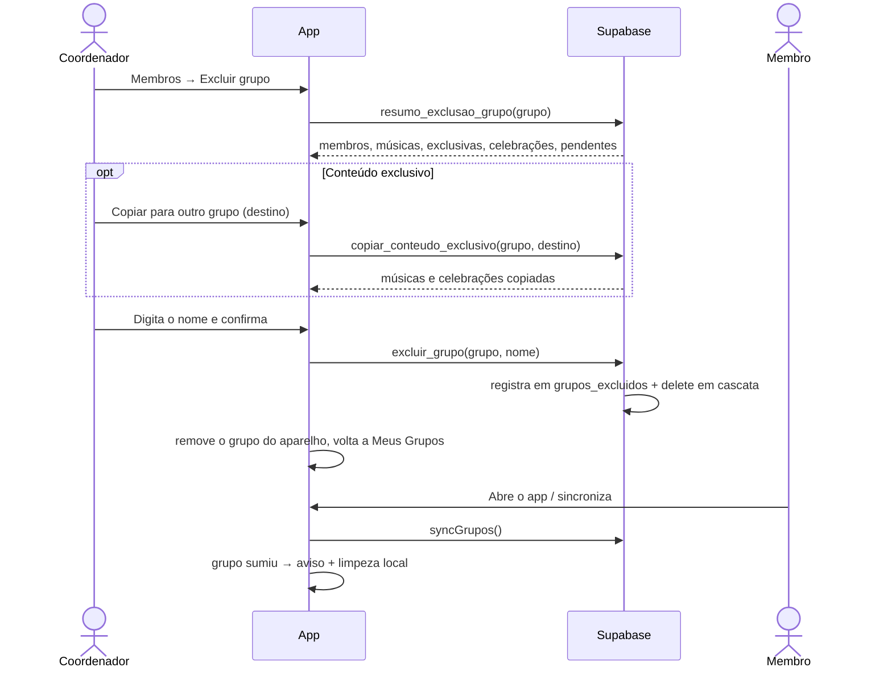

# Design — Excluir grupo

> Issue: [#61](https://github.com/abpaula77/Vozes_da_Catedral/issues/61) · Requisitos: [requirements.md](./requirements.md)
> Status: **rascunho para revisão**

## Visão geral

Mesmo padrão das #41, #42 e #52: as regras ficam em RPCs `security definer` no Supabase, e o app só chama e mostra o resultado.



## Banco de dados

Migration `supabase/migrations/20261120_excluir_grupo.sql`. É **aditiva** para o app atual, que não exclui grupos, com uma exceção: remove a regra de exclusão direta, que nenhuma versão do app usa (conferido no código).

### Regra de exclusão direta

```sql
drop policy if exists "Coordinators can delete their groups" on public.grupos;
```

Sem policy de `DELETE`, ninguém apaga grupos pela API; o único caminho é `excluir_grupo`. Isso fecha a falha de hoje, em que quem consta como criador apaga o grupo mesmo rebaixado a membro (requisitos 1.2 e 1.3).

### Tabela de auditoria `grupos_excluidos`

| Coluna | Tipo | Observação |
|---|---|---|
| `id` | `uuid` PK | `gen_random_uuid()` |
| `grupo_id` | `uuid` | sem FK (o grupo não existe mais) |
| `nome` | `text` | nome no momento da exclusão |
| `excluido_por` | `uuid` | sem FK, para sobreviver à exclusão da conta |
| `excluido_em` | `timestamptz` | `now()` |
| `totais` | `jsonb` | membros, músicas, celebrações, solicitações pendentes |

RLS ligado **sem policies** e `revoke all` de `public`, `anon` e `authenticated`: só o painel do Supabase lê (requisito 3.4). Sem dados de membros.

### Músicas exclusivas — `_musicas_exclusivas(p_grupo_id) → setof uuid`

Função interna (`security definer`, `stable`, sem `EXECUTE` para o app). Uma música `s` do grupo é exclusiva quando:

- **não** existe cópia dela em outro grupo (`musicas.copiada_de_id = s.id`); e
- **não** é cópia **idêntica** de uma música de outro grupo (`s.copiada_de_id` aponta para uma música que existe em outro grupo com o mesmo `conteudo_raw`).

Assim, uma cópia editada no grupo conta como exclusiva (ponto de atenção 7). Em 14/11/2026 dá 15 no Vozes Da Catedral e 5 no Grupo Jovem.

### RPCs

Todas com `security definer`, `search_path = ''`, sem `anon`, `grant execute to authenticated`.

| Função | Quem | O que faz | Requisitos |
|---|---|---|---|
| `resumo_exclusao_grupo(p_grupo_id) → table(membros, musicas, musicas_exclusivas, celebracoes, solicitacoes_pendentes)` | coordenador | Números para a tela de confirmação | 2.1 |
| `copiar_conteudo_exclusivo(p_origem, p_destino) → table(musicas, celebracoes)` | coordenador dos dois | Copia as músicas exclusivas e todas as celebrações | 4.2–4.6 |
| `excluir_grupo(p_grupo_id, p_confirmacao text) → void` | coordenador | Confere o nome, registra e apaga | 1.2, 3.1–3.4 |

#### `copiar_conteudo_exclusivo`

1. Rejeita se origem = destino, ou se o usuário não coordena **os dois** grupos.
2. Para cada música exclusiva da origem: `copy_song_to_group(musica, destino)`. Essa função já é idempotente por origem (índice único `grupo_id + copiada_de_id`), então repetir não duplica músicas (4.6).
3. Para cada celebração da origem: `copy_celebration_to_group(celebracao, destino)`. Ela já copia as músicas usadas na celebração (também idempotente) e recria os itens.
4. Tudo numa transação: se algo falhar, nada é copiado.
5. Devolve quantas músicas exclusivas e quantas celebrações foram copiadas.

Celebrações **não** são idempotentes: copiar de novo duplica. A tela desabilita o botão depois da primeira cópia (decisão 2 da revisão).

#### `excluir_grupo`

1. Usuário autenticado e coordenador do grupo; senão `Somente coordenadores podem excluir o grupo.`
2. `select ... for update` no grupo: trava a linha contra exclusões simultâneas.
3. `lower(btrim(nome)) = lower(btrim(p_confirmacao))`; senão `O nome digitado não confere com o nome do grupo.` A conferência no banco protege também contra chamadas diretas à API.
4. Calcula os totais, grava em `grupos_excluidos`.
5. `delete from public.grupos where id = p_grupo_id`. As FKs com `on delete cascade` apagam membros, músicas, celebrações, itens e solicitações. Cópias em outros grupos ficam, com `copiada_de_id = null`.

Tudo numa transação (requisito 3.3).

**Ponto a validar no teste:** a trigger `protect_last_coordinator` (#23) bloqueia remover o último coordenador. Ela foi escrita para liberar a cascata quando o grupo já não existe (`exists(select 1 from grupos ...)`). O teste SQL confirma que a exclusão em cascata passa; se não passar, a função libera a remoção por uma flag local da transação, como a `app.reatribuir_autor` da #42.

### Outras regras afetadas

- `set_criado_por` dispara no `UPDATE` que a cascata faz em cópias de outros grupos (`copiada_de_id = null`); ela só preserva o autor, sem efeito colateral.
- Itens de celebração de outros grupos não apontam para músicas deste grupo (regra da #23), então não são afetados.
- Exclusão de conta (#42): a mensagem já sugere "exclua esses grupos antes", o que passa a ser possível.

## App (Flutter)

### Banco local (Drift) — versão 5

- Tabela nova `AppMetaLocal` (`chave` texto, chave primária; `valor` texto). Guarda `dono_cache = <user_id>`.
- Migração `from < 5`: `createTable(appMetaLocal)`. Nenhuma tabela existente muda.
- Métodos novos em `AppDatabase`:
  - `removerConteudoDoGrupo(grupoId)`: numa transação, apaga itens das celebrações do grupo, celebrações, músicas, status de sincronização e o próprio grupo.
  - `limparTudo()`: apaga o conteúdo de todas as tabelas.
  - `lerMeta(chave)` / `gravarMeta(chave, valor)`.
- Construtor `AppDatabase.forTesting(QueryExecutor)` para testes com banco em memória.

### Cache por conta (requisito 6)

- `garantirDonoDoCache(userId)`: se `dono_cache` existir e for diferente de `userId`, chama `limparTudo()`; depois grava `dono_cache = userId`. Na primeira execução depois da atualização, `dono_cache` ainda não existe: o conteúdo atual é assumido como da conta logada, sem apagar nada.
- Provider `cacheLocalProntoProvider` (`FutureProvider`), que acompanha `currentUserIdProvider` e roda `garantirDonoDoCache`.
- **Onde é aguardado:** depois do login o app vai direto para Meus Grupos, sem passar pela abertura. Por isso `gruposProvider` aguarda `cacheLocalProntoProvider` antes de começar a ler o banco local. As demais telas que leem o banco local (hinário, detalhe da música, celebrações) são abertas a partir de um grupo e também aguardam o mesmo provider, para cobrir links diretos no Web.
- Sair da conta não apaga nada: a mesma conta, ao voltar, mantém o conteúdo offline (6.3).

### Sincronização e aviso (requisito 5)

- `syncGrupos()` passa a devolver os **nomes** dos grupos que estavam no aparelho e não vieram do servidor, e chama `removerConteudoDoGrupo` para cada um (5.3).
- Meus Grupos mostra, depois da sincronização (automática ao abrir ou manual), um aviso por grupo: "Você não participa mais do grupo X." (5.1, 5.2). Com o cache por conta, troca de conta não gera aviso (5.4).

### Serviço — `GruposService`

- `resumoExclusao(grupoId)`, `copiarConteudoExclusivo(origem, destino)`, `excluirGrupo(grupoId, confirmacao)`.
- Depois de `excluirGrupo`, chama `removerConteudoDoGrupo` no aparelho do coordenador, **sem** aviso para ele.
- Mensagens de erro do banco são mostradas como estão; outros erros viram "Esta ação precisa de internet." (1.4).

### Telas

**Membros (coordenador)**: no fim da lista, uma seção "Zona de perigo" com o botão **Excluir grupo** (cor de erro).

**Fluxo de exclusão** (diálogos em sequência, a partir do botão):

1. **Resumo** (carrega `resumo_exclusao_grupo`):
   - membros, músicas (e quantas são exclusivas), celebrações e solicitações pendentes;
   - "Músicas copiadas para outros grupos continuam existindo neles.";
   - "A exclusão é definitiva e não pode ser desfeita.";
   - botão **Copiar para outro grupo**, se houver músicas exclusivas ou celebrações; desabilitado depois de copiar, com "Conteúdo copiado para <destino>.";
   - botões **Cancelar** e **Continuar**.
2. **Destino da cópia**: lista dos outros grupos em que o usuário é coordenador (cache local). Se não houver: "Você não coordena outro grupo. Crie um grupo antes para receber o conteúdo." Ao copiar, mostra "N músicas e M celebrações copiadas para <destino>."
3. **Confirmação**: campo para digitar o nome do grupo; o botão **Excluir** só habilita quando o texto confere (sem diferenciar maiúsculas e espaços nas pontas).
4. Ao concluir: volta para Meus Grupos e mostra "Grupo X excluído."

## Tratamento de erros

| Situação | Resposta |
|---|---|
| Não coordenador | "Somente coordenadores podem excluir o grupo." |
| Nome não confere (chamada direta) | "O nome digitado não confere com o nome do grupo." |
| Destino inválido na cópia | Mensagem do banco (coordenador dos dois grupos) |
| Sem conexão | "Esta ação precisa de internet." |
| Grupo já excluído por outro coordenador | "Grupo não encontrado."; a tela volta para Meus Grupos e sincroniza |

## Testes

### Banco — `supabase/tests/excluir_grupo.sql` (transação revertida, contas descartáveis)

- `anon` não executa nenhuma RPC; `authenticated` não executa `_musicas_exclusivas` nem lê `grupos_excluidos`.
- Exclusão direta (`delete from grupos`) não apaga nada, inclusive para o criador rebaixado a membro.
- Membro comum não obtém resumo, não copia, não exclui.
- Resumo conta certo: membros, músicas, exclusivas (inclui cópia editada; exclui cópia idêntica e música copiada para fora), celebrações, pendentes.
- Cópia: exige coordenar os dois grupos; copia exclusivas e celebrações (com itens); repetir não duplica músicas.
- Exclusão: nome errado é recusado; nome com maiúsculas/espaços é aceito; apaga grupo, membros, músicas, celebrações, itens e solicitações; grava em `grupos_excluidos`; cópias em outros grupos continuam, com `copiada_de_id` nulo; a trigger do último coordenador não bloqueia a cascata.

### App

- Banco local em memória (`AppDatabase.forTesting`): `removerConteudoDoGrupo` apaga só o grupo indicado; `garantirDonoDoCache` limpa só quando a conta muda e não limpa na primeira execução.
- Telas: o botão Excluir só habilita com o nome certo; o botão de cópia desabilita depois de copiar.
- `flutter analyze` e `flutter test` limpos.

### Manual

Copiar o conteúdo de um grupo de teste para outro; excluir com nome errado e certo; conferir o aviso em outra conta que era membro; trocar de conta no mesmo aparelho e conferir que não aparecem grupos nem avisos da conta anterior. Web e Android.

## Publicação

1. Migration e testes SQL (o app atual continua funcionando).
2. Merge, deploy Web, APK.
3. Teste manual.
