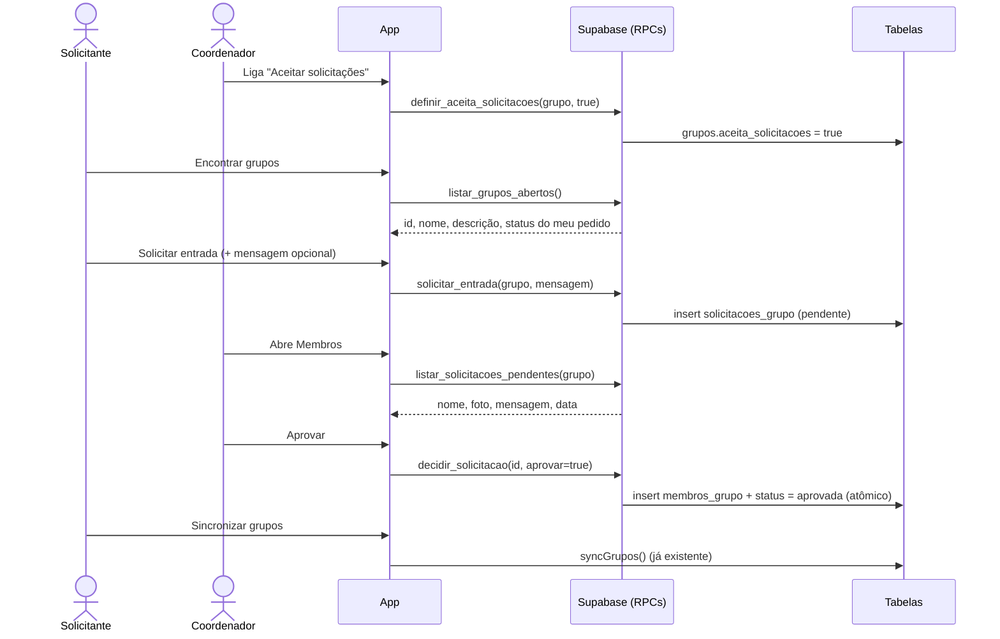

# Design — Pedido de filiação a grupos

> Issue: [#41](https://github.com/abpaula77/Vozes_da_Catedral/issues/41) · Requisitos: [requirements.md](./requirements.md)
> Status: **aprovado em 13/11/2026**

## Visão geral

O fluxo é **online e centralizado no banco**. Toda regra de negócio fica em RPCs `security definer` no Supabase, e o app apenas chama essas RPCs e mostra o resultado. Isso segue o padrão já usado em `create_group`, `add_group_member_by_email` e `update_my_profile`, e garante que as regras valham também para quem chamar a API diretamente.

Nada deste fluxo é guardado no SQLite local (Drift). Por isso **não há migração Drift**: pedidos e decisões dependem de conexão (requisito "Fora do escopo"), e o grupo aprovado chega ao cache local pela sincronização de grupos que já existe.



## Banco de dados

Todas as mudanças são **aditivas** (requisito 7.2). As versões atuais do app (Web e APK 0.1.1) continuam funcionando: `syncGrupos` usa `grupos(*)` e ignora a coluna nova, e o Drift grava só os campos que conhece.

Por isso a ordem de publicação é a **inversa** da usada na #24: primeiro a migration, depois o app.

### Coluna nova em `grupos`

```sql
alter table public.grupos
  add column if not exists aceita_solicitacoes boolean not null default false;
```

O valor padrão `false` cobre o requisito 1.1: grupos novos e os 4 existentes ficam fechados.

### Tabela `solicitacoes_grupo`

| Coluna | Tipo | Regra |
|---|---|---|
| `id` | `uuid` PK | `default gen_random_uuid()` |
| `grupo_id` | `uuid` | FK `grupos(id)` `on delete cascade` |
| `user_id` | `uuid` | FK `users(id)` `on delete cascade` |
| `status` | `text` | `check in ('pendente','aprovada','recusada','cancelada')`, default `pendente` |
| `mensagem` | `text` null | `check (char_length(mensagem) <= 280)` |
| `criada_em` | `timestamptz` | `default now()` |
| `decidida_em` | `timestamptz` null | preenchida ao aprovar, recusar ou cancelar |
| `decidida_por` | `uuid` null | FK `users(id)` `on delete set null`; auditoria (5.7) |

Índices:
- `unique (grupo_id, user_id) where status = 'pendente'`: um pedido pendente por pessoa e grupo (3.3), garantido pelo banco mesmo com requisições simultâneas.
- `(grupo_id) where status = 'pendente'`: acelera a lista e o contador do coordenador.

### Acesso direto bloqueado

- `alter table ... enable row level security` **sem nenhuma policy**, e `revoke all ... from public, anon, authenticated`.
- O cliente nunca lê nem escreve na tabela. Tudo passa pelas RPCs abaixo.
- Motivo: uma policy de leitura do próprio pedido exporia `decidida_por`, e o requisito 4.4 diz que o solicitante não vê quem decidiu. As RPCs devolvem só as colunas necessárias para cada papel.

### RPCs

Todas com `security definer`, `set search_path = ''`, `revoke all from public, anon` e `grant execute to authenticated` (6.6). Todas começam rejeitando `auth.uid() is null`.

| Função | Quem | O que faz | Requisitos |
|---|---|---|---|
| `definir_aceita_solicitacoes(p_grupo_id uuid, p_aceita boolean) → void` | coordenador | Liga ou desliga a opção. Não mexe nos pedidos pendentes. | 1.2–1.5 |
| `obter_aceita_solicitacoes(p_grupo_id uuid) → boolean` | membro | Lê o estado atual para o switch. | 1.6 |
| `listar_grupos_abertos() → table(id, nome, descricao, meu_status, pode_solicitar_em)` | qualquer usuário | Grupos com `aceita_solicitacoes = true` dos quais o usuário **não** é membro. `meu_status` é `pendente`, `recusada` ou `null`; `pode_solicitar_em` é a data de fim da espera, se houver. | 2.1–2.4, 6.7 |
| `solicitar_entrada(p_grupo_id uuid, p_mensagem text default null) → uuid` | qualquer usuário | Valida e cria o pedido `pendente`. | 3.1–3.6 |
| `listar_minhas_solicitacoes() → table(id, grupo_id, grupo_nome, status, mensagem, criada_em, pode_solicitar_em)` | solicitante | Pedidos `pendente` e `recusada` do próprio usuário. Não devolve `decidida_por`. | 4.1, 4.4 |
| `cancelar_solicitacao(p_solicitacao_id uuid) → void` | solicitante | Só o dono, só se `pendente`. Passa para `cancelada`. | 4.2 |
| `listar_solicitacoes_pendentes(p_grupo_id uuid) → table(id, user_id, nome, foto, mensagem, criada_em)` | coordenador | Pendentes do grupo, mais antigas primeiro. Única fonte de `foto`. | 5.1–5.3, 6.2, 6.4 |
| `contar_solicitacoes_pendentes() → table(grupo_id, total)` | coordenador | Total de pendentes por grupo que o usuário coordena. | 5.1, 5.8 |
| `decidir_solicitacao(p_solicitacao_id uuid, p_aprovar boolean) → void` | coordenador | Aprova ou recusa, de forma atômica. | 5.4–5.7 |

#### Regras de `solicitar_entrada`

Na ordem:
1. Grupo inexistente **ou fechado** → `Grupo não encontrado ou não está aceitando solicitações.` A mesma mensagem nos dois casos, para não revelar que um grupo fechado existe (6.7).
2. Já é membro → `Você já faz parte deste grupo.`
3. Mensagem: `btrim`, vazia vira `null`, mais de 280 caracteres → erro (3.2).
4. Última solicitação `recusada` com `decidida_em > now() - interval '7 days'` → `Você poderá solicitar novamente a partir de DD/MM/AAAA.` (3.6).
5. `insert` em `solicitacoes_grupo`. Se violar o índice único de pendente → `Você já tem uma solicitação pendente para este grupo.` (3.3).

#### Regras de `decidir_solicitacao`

1. `select ... for update` na solicitação: trava a linha, então dois coordenadores decidindo ao mesmo tempo são serializados (5.6).
2. Não encontrada ou não é coordenador do grupo → `Solicitação não encontrada.`
3. Status diferente de `pendente` → `Esta solicitação já foi decidida.` É o que o segundo coordenador recebe (5.6).
4. Aprovar → `insert into membros_grupo (..., 'membro') on conflict do nothing` e status `aprovada`. O `on conflict` cobre o caso de a pessoa ter sido convidada por e-mail enquanto o pedido esperava.
5. Recusar → status `recusada`.
6. Grava `decidida_em = now()` e `decidida_por = auth.uid()` (5.7).

Tudo roda dentro da mesma função, então o insert do membro e a mudança de status acontecem juntos ou não acontecem (5.4).

### Interação com regras existentes

- **Último coordenador** (`protect_last_coordinator`): não é afetado, porque a aprovação só **insere** membros (7.3).
- **Convite por e-mail** (`add_group_member_by_email`): o comportamento para o app não muda (7.1). Se a pessoa entrar pelo convite com um pedido pendente, a função passa a marcar esse pedido como `aprovada` (com `decidida_por` = quem convidou). Assim o coordenador não vê um pedido de quem já é membro. Ver ponto de decisão 2.
- **Defesa extra**: `listar_solicitacoes_pendentes` e `contar_solicitacoes_pendentes` ignoram pedidos de quem já é membro, caso algum membro entre por outro caminho.
- **Exclusão do grupo ou da conta**: as FKs `on delete cascade` apagam os pedidos.
- **`users.foto`**: continua sem `SELECT` direto. A foto sai só por `listar_solicitacoes_pendentes`, e só de quem tem pedido pendente no grupo (6.2, 6.4).

## App (Flutter)

### Camada de domínio — `lib/features/groups/domain/solicitacao_model.dart`

- `enum StatusSolicitacao { pendente, aprovada, recusada, cancelada }` com `fromString`.
- `GrupoAbertoModel` (`id`, `nome`, `descricao`, `meuStatus`, `podeSolicitarEm`), com getter `podeSolicitar`.
- `MinhaSolicitacaoModel` (`id`, `grupoId`, `grupoNome`, `status`, `mensagem`, `criadaEm`, `podeSolicitarEm`).
- `SolicitacaoPendenteModel` (`id`, `userId`, `nome`, `foto`, `mensagem`, `criadaEm`).
- Cada um com `fromJson`, seguindo o padrão de `group_model.dart`.

### Camada de dados — `lib/features/groups/data/solicitacoes_provider.dart`

`SolicitacoesService` chama as RPCs (mesmo padrão de `GruposService`). Providers Riverpod:

| Provider | Tipo | Uso |
|---|---|---|
| `gruposAbertosProvider` | `FutureProvider.autoDispose` | Tela Encontrar grupos |
| `minhasSolicitacoesProvider` | `FutureProvider.autoDispose` | Tela Encontrar grupos |
| `solicitacoesPendentesProvider` | `FutureProvider.autoDispose.family<String>` | Tela de membros |
| `contagemSolicitacoesProvider` | `FutureProvider.autoDispose` | Badge em Meus Grupos |
| `aceitaSolicitacoesProvider` | `FutureProvider.autoDispose.family<String>` | Switch na tela de membros |

Depois de cada ação (solicitar, cancelar, decidir, alternar), o provider afetado é invalidado. Isso segue o padrão atual (`ref.invalidate(membrosGrupoProvider(...))`).

Erros vêm como `PostgrestException`. O app mostra `error.message` num `SnackBar`, já que as mensagens das RPCs estão escritas para o usuário. Erros de rede viram `Sem conexão. Esta função precisa de internet.` (2.6).

### Telas

**1. Meus Grupos (`groups_screen.dart`)**
- Novo botão na AppBar: "Encontrar grupos" (`Icons.travel_explore`).
- No estado vazio, abaixo de "Crie um grupo para começar", um botão "Encontrar um grupo". É o caminho natural de um usuário novo.
- No `_GrupoCard` de grupos que o usuário coordena: `Badge` com o total de pendentes (5.8). A contagem é buscada junto com a sincronização de grupos; se falhar, o badge simplesmente não aparece.

**2. Encontrar grupos (nova, `explore_groups_screen.dart`, rota `/explore`)**
- Seção "Minhas solicitações", exibida só se houver pedidos: grupo, status (`Pendente` ou `Recusada — você pode pedir de novo a partir de DD/MM`) e botão "Cancelar" nos pendentes.
- Campo de filtro por nome (2.3), filtrando no app.
- Lista de grupos abertos com nome e descrição. Ação conforme o estado: botão "Solicitar entrada", chip "Pendente" ou chip "Recusado até DD/MM" (2.4).
- "Solicitar entrada" abre um diálogo com campo de mensagem opcional (`maxLength: 280`, contador visível) e botões Cancelar e Enviar.
- Estados vazio e sem conexão com mensagens próprias (2.5, 2.6).
- A rota fica fora de `/groups/:grupoId` para não ser confundida com um id de grupo.

**3. Membros (`group_members_screen.dart`), só para coordenadores**
- No topo, `SwitchListTile` "Aceitar solicitações de entrada", com o texto "Quando ligado, o grupo aparece em Encontrar grupos." (1.6).
- Seção "Solicitações pendentes (N)", exibida só se N > 0: avatar com a foto (`NetworkImage`) ou a inicial, nome, data, mensagem e botões "Recusar" e "Aprovar" (5.1, 5.2).
- "Recusar" pede confirmação ("Fulano só poderá pedir de novo em 7 dias"). "Aprovar" é direto.
- Depois de decidir, a lista de membros e a de pendentes são recarregadas.
- A foto vem do Google (`lh3.googleusercontent.com`), e a CSP já libera `img-src https:`.

### Navegação

- `AppRoutes.exploreGroups = '/explore'` e o helper `context.pushExploreGroups()` em `app_router.dart`.

## Tratamento de erros

| Situação | Resposta |
|---|---|
| Grupo fechado ou inexistente | Mensagem única (6.7); a lista é recarregada |
| Pedido duplicado | "Você já tem uma solicitação pendente…" |
| Dentro da espera de 7 dias | Mensagem com a data; o botão já aparece desabilitado pela lista |
| Já é membro | "Você já faz parte deste grupo." |
| Decisão concorrente | "Esta solicitação já foi decidida."; a lista é recarregada |
| Sem conexão | Mensagem de internet necessária, com botão "Tentar novamente" |

## Testes

### Banco (no Supabase, em transação revertida, como nas #23 e #24)

Um script cobrindo, com duas contas de teste simuladas por `request.jwt.claims`:
- `anon` não executa nenhuma RPC (6.6) e nenhum papel lê ou grava a tabela diretamente.
- Grupo fechado não aparece em `listar_grupos_abertos` e recusa `solicitar_entrada` com a mensagem genérica (1.3, 3.5, 6.7).
- Membro não solicita (3.4); pedido duplicado é bloqueado (3.3); mensagem acima de 280 é recusada (3.2).
- Recusa bloqueia novo pedido por 7 dias, e um pedido com `decidida_em` de 8 dias atrás é liberado (3.6).
- Cancelar libera novo pedido imediatamente (4.2); só o dono cancela.
- Não coordenador não lista, não conta, não decide e não alterna a opção (1.5, 6.5).
- Aprovar insere em `membros_grupo` como `membro` e muda o status (5.4); segunda decisão falha (5.6).
- `listar_solicitacoes_pendentes` devolve foto só de pendentes e nunca e-mail (5.3, 6.2, 6.3).
- Fechar o grupo mantém os pendentes (1.4).

O script fica versionado em `supabase/tests/solicitacoes_grupo.sql` para ser rodado de novo depois.

### App

- Testes de unidade dos modelos (`fromJson`, `StatusSolicitacao.fromString`, `podeSolicitar`, formatação da data de espera).
- `flutter analyze` e `flutter test` limpos.

### Manual (duas contas reais)

Coordenador abre o grupo → outra conta encontra e pede com mensagem → coordenador vê nome, foto e mensagem e aprova → solicitante sincroniza e vê o grupo. Repetir com recusa e conferir a espera. Testar no Web e no Android.

## Publicação

1. Migration no Supabase (aditiva, não quebra o app atual) + testes SQL.
2. Merge, deploy Web, APK novo.
3. Teste manual com duas contas.
4. Fechar a #41.

## Decisões da revisão (13/11/2026)

1. **Switch "Aceitar solicitações"**: fica na tela de membros, junto com as solicitações pendentes.
2. **Pedido pendente de quem entra por convite de e-mail**: passa a `aprovada` automaticamente, com `decidida_por` = quem convidou.
   - Só ocorre quando o e-mail **já está cadastrado**: a pessoa pediu entrada e, antes da decisão, um coordenador a convidou pelo e-mail.
   - Se o e-mail não está cadastrado, o convite continua sem efeito, como hoje (nada é guardado, nenhum e-mail é enviado, não revela se a conta existe). Ver wish list nos requisitos.
